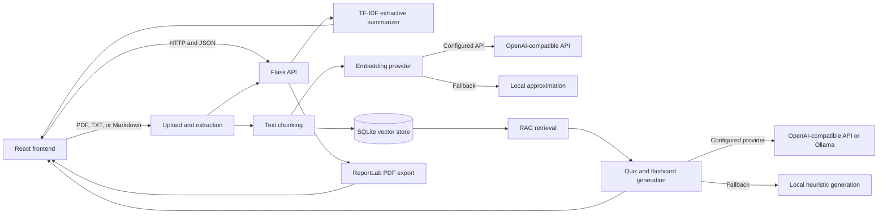

# NoteBot — Premium AI Notes Platform

NoteBot turns study material into concise summaries, flashcards, and quizzes. It pairs a React and Vite frontend with a Flask API, local document indexing, and optional language-model generation.

> **Runtime note:** This repository contains optional OpenAI-compatible and Ollama integrations. Their presence does not mean a hosted deployment is currently configured to use them; provider, credentials, network access, and model availability are determined by runtime environment settings.

## Overview

Students often have to turn long lecture notes and documents into practical revision material. NoteBot provides a single workspace to extract text, review key points, and create study aids grounded in an uploaded or pasted source.

### Objectives

- Reduce the effort required to prepare study material.
- Keep generated questions and cards tied to the source document.
- Support local development without requiring paid AI credentials.
- Keep deployment split between a static frontend and a lightweight Python API.

### Features

- Upload PDF, TXT, and Markdown files, or paste text.
- Extract text from PDFs and index it for later retrieval.
- Create extractive summaries, keywords, and compression statistics.
- Generate document-grounded flashcards and multiple-choice quizzes.
- Fall back to local heuristic generation when LLM generation is unavailable.
- Export summaries and study material to PDF.
- Responsive React interface with route navigation, loading states, and health checks.

## Technology stack

| Area | Technologies |
| --- | --- |
| Frontend | React 18, Vite, Tailwind CSS, Framer Motion, Zustand |
| UI and requests | Lucide React, React Dropzone, React Hot Toast, Axios, clsx |
| Backend | Python 3.10+, Flask, Flask-CORS, python-dotenv, Gunicorn |
| Documents and export | PyMuPDF, ReportLab |
| AI and retrieval | OpenAI Python SDK, SQLite-backed vector store, NumPy |
| Tests | pytest, Node.js built-in test runner |

## AI and document architecture

### Summarization

The current summarizer is a lightweight extractive TF-IDF implementation. It selects sentences from the input and ranks keywords locally; summarization does **not** call an LLM.

### OpenAI-compatible generation

The backend defaults to `gpt-4o-mini` for text generation and `text-embedding-3-small` for embeddings when those model settings are used. An `OPENAI_API_KEY` is required for calls to the configured OpenAI-compatible API. `OPENAI_BASE_URL` can select an alternate compatible endpoint; Ollama is also supported through its own settings.

These are code defaults, not proof that either model is enabled in a deployed environment. Without a usable remote embedding API, indexing uses a deterministic local approximation. Flashcard and quiz generation can fall back to local, source-based heuristics if LLM generation fails. Set up and test provider credentials in the backend environment before relying on model-generated output.

### RAG architecture

When a document is uploaded or pasted, the backend chunks its extracted text, creates embeddings, and stores chunks in a local SQLite database. Generation requests use the returned document ID to retrieve source chunks and build the LLM prompt. Generated responses are validated, with a local fallback available for generation failures.

The vector database is runtime data, not a checked-in dataset. It is excluded from Git. A deployment with an ephemeral filesystem should not be expected to retain indexed documents across restarts or redeployments.

### PDF processing workflow

1. The upload route accepts PDF, TXT, or Markdown files.
2. PyMuPDF extracts text from PDF pages; text files are decoded as UTF-8.
3. Empty or unreadable documents are rejected. Image-only PDFs are not OCR-processed.
4. Extracted text is chunked, embedded, and indexed in SQLite for retrieval.
5. The frontend can request a summary and use the document ID for flashcards and quizzes.

### Quiz generation workflow

The quiz endpoint retrieves document chunks and asks the configured LLM for structured questions. Responses are validated and deduplicated. If LLM generation fails, a local generator extracts concept statements from the indexed text and builds questions from those statements. The endpoint reports which generation path was used.

### Flashcard generation workflow

The flashcard endpoint retrieves indexed document chunks and requests source-grounded cards from the configured LLM. The response is validated; if generation fails, a local heuristic extractor creates cards from suitable statements in the document.

### PDF export workflow

The export endpoint uses ReportLab to create a downloadable PDF from provided summaries, keywords, flashcards, and quiz questions.

### System architecture



## Project structure

```text
.
├── backend/
│   ├── app/
│   │   ├── routes/       # Upload, summary, quiz, cards, export, and admin APIs
│   │   └── services/     # PDF/text processing, RAG, generation, and validation
│   ├── tests/
│   ├── .env.example
│   ├── requirements.txt
│   └── run.py
├── frontend/
│   ├── public/
│   ├── screenshots/
│   ├── src/
│   │   ├── components/
│   │   ├── data/
│   │   ├── pages/
│   │   ├── store/
│   │   ├── styles/
│   │   └── utils/
│   ├── tests/
│   ├── .env.example
│   └── package.json
├── render.yaml
└── README.md
```

## Local setup

### Prerequisites

- Node.js 18 or newer and npm.
- Python 3.10 or newer.
- An OpenAI-compatible API key only if remote model generation or embeddings are desired.

### Backend

From the repository root, create and activate a virtual environment, install dependencies, and create the local environment file.

**Windows PowerShell**

```powershell
cd backend
py -m venv .venv
.\.venv\Scripts\Activate.ps1
python -m pip install -r requirements.txt
Copy-Item .env.example .env
```

**macOS or Linux**

```bash
cd backend
python3 -m venv .venv
source .venv/bin/activate
python -m pip install -r requirements.txt
cp .env.example .env
```

Edit `backend/.env` as needed, then start the API:

```bash
python run.py
```

The backend listens on `http://localhost:5000` by default. `PORT` can override the port.

### Frontend

In a second terminal:

```bash
cd frontend
npm install
```

Optionally create `frontend/.env.local` from the example. For local development, the configured API base URL should be `http://localhost:5000`.

```powershell
Copy-Item .env.example .env.local
npm run dev
```

The Vite development server is available at `http://localhost:5173`.

### Environment variables

The backend reads `backend/.env`; the Vite frontend reads its own environment file. Keep real credentials out of both files in Git.

| Variable | Purpose |
| --- | --- |
| `OPENAI_API_KEY` | Backend credential for the configured OpenAI-compatible API |
| `OPENAI_GENERATION_MODEL` | Generation model; code default is `gpt-4o-mini` |
| `OPENAI_EMBEDDING_MODEL` | Embedding model; code default is `text-embedding-3-small` |
| `OPENAI_BASE_URL` | Optional API-compatible endpoint override |
| `LLM_PROVIDER` | Provider preference (`auto`, `openai`, `openrouter`, or `ollama`) |
| `OLLAMA_BASE_URL` | Ollama-compatible API URL; defaults to `http://localhost:11434/v1` |
| `OLLAMA_MODEL` | Ollama model; code default is `qwen2.5:3b` |
| `RAG_TOP_K` | Maximum retrieval context size |
| `RAG_CHUNK_SIZE` / `RAG_CHUNK_OVERLAP` | Document chunking parameters |
| `ADMIN_API_KEY` | Optional key for protected administrative routes |
| `VITE_API_BASE_URL` | Frontend API origin; use the backend origin, without a trailing `/api` |

Templates are provided at `backend/.env.example` and `frontend/.env.example`. The frontend variable is public at build time; never put API keys or other secrets in `VITE_*` variables.

## API overview

| Method | Path | Purpose |
| --- | --- | --- |
| `GET` | `/api/health` | Backend health check |
| `POST` | `/api/upload/` | Upload a PDF, TXT, or Markdown file |
| `POST` | `/api/upload/text/` | Index pasted text |
| `POST` | `/api/summarize/` | Generate an extractive summary and keywords |
| `POST` | `/api/flashcards/` | Generate cards from an indexed document ID |
| `POST` | `/api/quiz/` | Generate questions from an indexed document ID |
| `POST` | `/api/export/pdf` | Export study content to PDF |

Administrative routes are defined in `backend/app/routes/admin.py`; configure `ADMIN_API_KEY` before exposing administrative actions.

## Tests and build

Run the frontend tests and production build:

```bash
cd frontend
npm test
npm run build
```

Run the backend test suite from the backend directory:

```bash
cd backend
python -m pytest -q tests
```

This runs the backend unit tests in `backend/tests`. The separate `backend/test_rag_integration.py` script targets a running local API and requires the optional `requests` package; it is not part of this pytest command. Tests that call external AI providers require provider configuration; do not treat a successful local fallback as a live-provider integration test.

## Deployment

- **Backend:** the root `render.yaml` describes the Render web service. Configure runtime secrets and model settings in Render's environment settings rather than committing them.
- **Frontend:** deploy the `frontend/` directory to Vercel, using `npm run build` and `dist` as the output directory. Set `VITE_API_BASE_URL` to the deployed backend origin.
- **SPA routing:** `frontend/vercel.json` and `frontend/public/_redirects` provide single-page-app rewrites for supported static hosts.
- **CORS:** the current Flask app uses a permissive CORS configuration. Restrict allowed origins to the deployed frontend before using the API publicly.
- **Persistence:** the vector index is stored on the backend filesystem. Configure persistent storage if indexed documents must survive a host restart or redeployment.

Deployment configuration in the repository does not establish that a live Render or Vercel deployment is currently available or healthy.

## Screenshots

Representative UI captures are available in [`frontend/screenshots/`](frontend/screenshots/).

### Workspace


### Flashcards


## Future enhancements

- Add OCR for scanned and image-only PDFs.
- Add user authentication and per-user document isolation.
- Restrict CORS and add API rate limits for public deployments.
- Use a persistent, managed vector database for production deployments.
- Add provider integration tests and deployment health checks.
- Add accessible end-to-end tests across desktop and mobile layouts.

## Contributing

Open an issue to discuss a bug or proposed change, then submit a focused pull request with relevant tests and setup notes. Do not include private documents, generated vector databases, environment files, or credentials in contributions.

## License

There is currently no `LICENSE` file in this repository. Until a license is selected and added, the project is not explicitly licensed for reuse or redistribution. Choose a license before accepting external contributions or publishing this as an open-source package.
