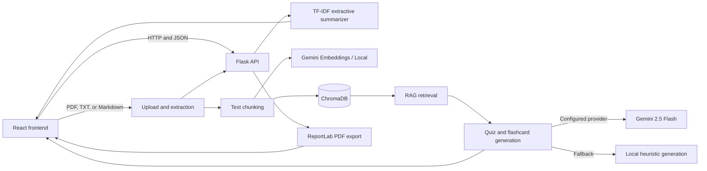

# NoteBot — Premium AI Notes Platform

NoteBot turns study material into concise summaries, flashcards, and quizzes. It pairs a React and Vite frontend with a Flask API, persistent document indexing, and Gemini-powered generation.

## Overview

Students often have to turn long lecture notes and documents into practical revision material. NoteBot provides a single workspace to extract text, review key points, and create study aids grounded in an uploaded or pasted source.

### Objectives

- Reduce the effort required to prepare study material.
- Keep generated questions and cards tied to the source document.
- Support local development without requiring paid AI credentials.
- Keep deployment split between a static frontend and a lightweight Python API.

### Features

- Upload PDF, TXT, and Markdown files, or paste text.
- Extract text from PDFs and index it for later retrieval.
- Create extractive summaries, keywords, and compression statistics.
- Generate document-grounded flashcards and multiple-choice quizzes.
- Sign in to manage owned documents, cited chatbot conversations, and study history.
- Shuffle and track flashcard reviews; save quiz answers, scores, and answer explanations.
- Fall back to local heuristic generation when LLM generation is unavailable.
- Export summaries and study material to PDF.
- Responsive React interface with route navigation, loading states, and health checks.

## Technology stack

| Area | Technologies |
| --- | --- |
| Frontend | React 18, Vite, Tailwind CSS, Framer Motion, Zustand |
| UI and requests | Lucide React, React Dropzone, React Hot Toast, Axios, clsx |
| Backend | Python 3.10+, Flask, Flask-CORS, Flask-SQLAlchemy, Flask-Migrate, Flask-JWT-Extended, PyMySQL, python-dotenv, Gunicorn |
| Documents and export | PyMuPDF, ReportLab |
| AI and retrieval | Google Gen AI SDK (Gemini 2.5 Flash, `gemini-embedding-001`), ChromaDB, optional local Sentence Transformers (`all-MiniLM-L6-v2`) |
| Tests | pytest, Node.js built-in test runner |

## AI and document architecture

### Summarization

The current summarizer is a lightweight extractive TF-IDF implementation. It selects sentences from the input and ranks keywords locally; summarization does **not** call an LLM.

### Gemini generation

Flashcard and quiz generation now use the Google Gen AI SDK with `gemini-2.5-flash`. Set `GEMINI_API_KEY` in the backend environment. Requests have a configurable timeout, bounded retry handling, quota/rate-limit errors, and JSON response validation. Local source-grounded generators remain available when Gemini is unavailable.

Embeddings default to Google's `gemini-embedding-001` via the official `google-genai` SDK with 3072 dimensions, using `RETRIEVAL_DOCUMENT` for chunk indexing and `RETRIEVAL_QUERY` for retrieval queries. This eliminates large PyTorch and model weights from production builds, keeping memory well below Render's 512 MB free tier ceiling. A deferred local Sentence Transformers (`all-MiniLM-L6-v2`) fallback is available for offline development by setting `ENABLE_LOCAL_EMBEDDINGS=true` and installing `backend/requirements-local.txt`. If no embedding provider is configured, uploads return a clean HTTP 503 rather than crashing or storing invalid vectors.

### RAG architecture

When a document is uploaded or pasted, the backend creates a relational document record, chunks its extracted text, creates embeddings, and stores chunks in the persistent `notebot_documents` ChromaDB collection. Retrieval filters by both document and user. Flashcards and quiz questions are persisted in the relational database and associated with the document. Generation requests retrieve source chunks and build the Gemini prompt. Generated responses are validated, with a local fallback available for generation failures.

The vector database is runtime data, not a checked-in dataset. It is excluded from Git and stored under `CHROMA_PERSIST_DIRECTORY`. Existing legacy SQLite indexes are imported into Chroma on first access with ownership metadata. Records whose owners cannot be resolved remain unavailable to user-scoped retrieval until reindexed.

### Relational persistence and migrations

The backend uses SQLAlchemy and Flask-Migrate for users, documents, conversations, messages, flashcards, quizzes, attempts, and revoked JWTs. Uploads, generated content, chat history, flashcard reviews, and quiz attempts are persisted. Protected API operations enforce user ownership.

Set `DATABASE_URL` to a MySQL connection string before running migrations. Apply the schema from the backend directory with `python -m flask --app run db upgrade`. `NOTEBOT_AUTO_CREATE_SCHEMA` is intended only for isolated tests; production schema changes should use migrations.

### PDF processing workflow

1. The upload route accepts PDF, TXT, or Markdown files.
2. PyMuPDF extracts text from PDF pages; text files are decoded as UTF-8.
3. Empty or unreadable documents are rejected. Image-only PDFs are not OCR-processed.
4. Extracted text is chunked, embedded, and indexed in ChromaDB for retrieval.
5. The frontend can request a summary and use the document ID for flashcards and quizzes.

### Quiz generation workflow

The quiz endpoint retrieves document chunks and asks Gemini for validated four-option questions. Question count is configurable up to 15. Correct answers and explanations are reviewed in the existing UI; each authenticated answer is persisted and can be retrieved from the user's quiz history. If Gemini generation fails, a local source-grounded generator is used and the endpoint reports which path ran.

### Flashcard generation workflow

The flashcard endpoint retrieves indexed document chunks and requests source-grounded cards from Gemini, including topic, difficulty, and supported PDF page references. Saved cards are deduplicated; revealing an answer records a review. The existing card UI supports navigation and shuffle. If Gemini generation fails, a local heuristic extractor remains available.

### Chat workflow

Authenticated users can create multiple conversations for their documents, send follow-up questions, and revisit stored message history. Responses use document-scoped RAG context and include validated source-page citations; questions unsupported by retrieved context are handled as unanswerable.

### PDF export workflow

The export endpoint uses ReportLab to create a downloadable PDF from provided summaries, keywords, flashcards, and quiz questions.

### System architecture



## Project structure

```text
.
├── backend/
│   ├── app/
│   │   ├── routes/       # Upload, summary, quiz, cards, export, and admin APIs
│   │   └── services/     # PDF/text processing, RAG, generation, and validation
│   ├── tests/
│   ├── .env.example
│   ├── requirements.txt
│   ├── requirements-local.txt
│   └── run.py
├── frontend/
│   ├── public/
│   ├── src/
│   │   ├── components/
│   │   ├── data/
│   │   ├── pages/
│   │   ├── store/
│   │   ├── styles/
│   │   └── utils/
│   ├── tests/
│   ├── .env.example
│   └── package.json
├── render.yaml
└── README.md
```

## Local setup

### Prerequisites

- Node.js 18 or newer and npm.
- Python 3.10 or newer.
- A Gemini API key for hosted generation; Sentence Transformers downloads `all-MiniLM-L6-v2` on first use.

### Backend

From the repository root, create and activate a virtual environment, install dependencies, and create the local environment file.

**Windows PowerShell**

```powershell
cd backend
py -m venv .venv
.\.venv\Scripts\Activate.ps1
python -m pip install -r requirements.txt
Copy-Item .env.example .env
```

**macOS or Linux**

```bash
cd backend
python3 -m venv .venv
source .venv/bin/activate
python -m pip install -r requirements.txt
cp .env.example .env
```

Edit `backend/.env` as needed, then start the API:

```bash
python -m flask --app run db upgrade
python run.py
```

The backend listens on `http://localhost:5000` by default. `PORT` can override the port.

### Frontend

In a second terminal:

```bash
cd frontend
npm install
```

Optionally create `frontend/.env.local` from the example. For local development, the configured API base URL should be `http://localhost:5000`.

```powershell
Copy-Item .env.example .env.local
npm run dev
```

The Vite development server is available at `http://localhost:5173`.

### Environment variables

The backend reads `backend/.env`; the Vite frontend reads its own environment file. Keep real credentials out of both files in Git.

| Variable | Purpose |
| --- | --- |
| `DATABASE_URL` | SQLAlchemy connection string; configure MySQL for deployments |
| `NOTEBOT_AUTO_CREATE_SCHEMA` | Test-only switch for creating tables without migrations |
| `UPLOAD_FOLDER` | Private filesystem location for uploaded source files |
| `CHROMA_PERSIST_DIRECTORY` | Persistent ChromaDB data directory |
| `GEMINI_API_KEY` | Backend credential for Gemini generation and embeddings |
| `GEMINI_EMBEDDING_MODEL` | Gemini embedding model name (default: `gemini-embedding-001`) |
| `GEMINI_EMBEDDING_DIMENSION` | Gemini embedding dimension (default: `3072`) |
| `ENABLE_LOCAL_EMBEDDINGS` | Set to `true` to enable deferred Sentence Transformers fallback |
| `LOCAL_EMBEDDING_MODEL` | Local embedding model (default: `sentence-transformers/all-MiniLM-L6-v2`) |
| `LOCAL_EMBEDDING_DEVICE` | Hardware device for local embeddings (`cpu`, `cuda`, `mps`) |
| `MIN_RETRIEVAL_SCORE` | Minimum similarity score cutoff for retrieval |
| `GEMINI_TIMEOUT_SECONDS` | Gemini request timeout; default is 45 seconds |
| `RAG_TOP_K` | Maximum retrieval context size |
| `RAG_CHUNK_SIZE` / `RAG_CHUNK_OVERLAP` | Document chunking parameters |
| `ADMIN_API_KEY` | Key for protected administrative routes (e.g., `/api/admin/reindex`) |
| `CORS_ORIGINS` | Comma-separated list or JSON array of allowed origins |
| `VITE_API_URL` | Frontend API origin; use the backend origin, without a trailing `/api` |

Templates are provided at `backend/.env.example` and `frontend/.env.example`. The frontend variable is public at build time; never put API keys or other secrets in `VITE_*` variables.

## API overview

| Method | Path | Purpose |
| --- | --- | --- |
| `GET` | `/api/health` | Backend health check |
| `POST` | `/api/auth/register` | Register a user and issue a JWT |
| `POST` | `/api/auth/login` | Authenticate and issue a JWT |
| `GET` | `/api/auth/me` | Return the authenticated user's profile |
| `POST` | `/api/auth/logout` | Revoke the current JWT |
| `POST` | `/api/upload/` | Upload a PDF, TXT, or Markdown file |
| `POST` | `/api/upload/text/` | Index pasted text |
| `DELETE` | `/api/documents/<doc_id>` | Delete an owned document and its ChromaDB vectors |
| `POST` | `/api/summarize/` | Generate an extractive summary and keywords |
| `POST` | `/api/flashcards/` | Generate cards from an indexed document ID |
| `POST` | `/api/flashcards/<card_id>/review` | Record a review for an owned flashcard |
| `POST` | `/api/quiz/` | Generate questions from an indexed document ID |
| `POST` | `/api/quiz/attempts` | Save an answer and return correctness/explanation |
| `GET` | `/api/quiz/attempts?doc_id=<doc_id>` | List the authenticated user's quiz attempts |
| `GET` / `POST` | `/api/chat/conversations` | List or create owned conversations |
| `GET` / `POST` | `/api/chat/conversations/<id>/messages` | Read history or send a chat message |
| `POST` | `/api/export/pdf` | Export study content to PDF |
| `POST` | `/api/admin/reindex` | Safely reindex a document with active embeddings (`X-Admin-Key` required) |
| `GET` | `/api/admin/inspect_index` | Inspect chunks and metadata for a document (`X-Admin-Key` required) |

### Administrative reindexing

When migrating between embedding models (e.g. from local 384-dim embeddings to Gemini 3072-dim embeddings), use the protected `/api/admin/reindex` endpoint to regenerate vector chunks:

```bash
curl -X POST https://<your-backend-host>/api/admin/reindex \
  -H "Content-Type: application/json" \
  -H "X-Admin-Key: <ADMIN_API_KEY>" \
  -d '{"doc_id": "<document_id>"}'
```

The reindex endpoint validates newly generated embeddings before replacing any existing chunks, ensuring atomic rollbacks if an error occurs.

## Tests and build

Run the frontend tests and production build:

```bash
cd frontend
npm test
npm run build
```

Run the backend test suite from the backend directory:

```bash
cd backend
python -m pytest -q tests
```

This runs the full backend unit and integration test suite across all services and routes. Automated generation tests mock provider responses; successful local-fallback tests are not live-provider integration tests.

## Deployment

- **Backend:** the root `render.yaml` describes the Render web service with optimized single-worker 4-thread Gunicorn configuration designed for Render's 512 MB free tier. Configure runtime secrets and model settings in Render's environment settings rather than committing them.
- **Frontend:** deploy the `frontend/` directory to Vercel, using `npm run build` and `dist` as the output directory. Set `VITE_API_URL` to the deployed backend origin.
- **SPA routing:** `frontend/vercel.json` and `frontend/public/_redirects` provide single-page-app rewrites for supported static hosts.
- **CORS:** configurable via `CORS_ORIGINS`. Preflight and standard headers are explicitly handled on all routes.
- **Persistence:** relational records use `DATABASE_URL`; uploaded files and the ChromaDB index use filesystem storage. Configure durable database and filesystem storage before deploying.

Deployment configuration in the repository does not establish that a live Render or Vercel deployment is currently available or healthy.

## Future enhancements

- Add OCR for scanned and image-only PDFs.
- Add OCR for scanned and image-only PDFs.
- Restrict CORS and add API rate limits for public deployments.
- Verify MySQL connectivity and production migrations; tests currently use isolated SQLite.
- Import and validate the legacy vector index against a deployed relational database and Chroma store.
- Use managed/durable storage for production uploads and vector data.
- Add live-provider integration tests and accessible end-to-end coverage across desktop and mobile layouts.
- Add accessible end-to-end tests across desktop and mobile layouts.

## Contributing

Open an issue to discuss a bug or proposed change, then submit a focused pull request with relevant tests and setup notes. Do not include private documents, generated vector databases, environment files, or credentials in contributions.

## License

There is currently no `LICENSE` file in this repository. Until a license is selected and added, the project is not explicitly licensed for reuse or redistribution. Choose a license before accepting external contributions or publishing this as an open-source package.
