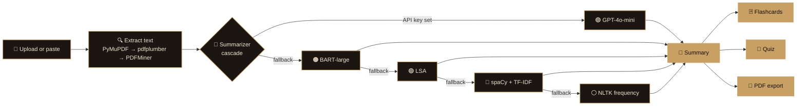

<div align="center">


<br/>

[](https://www.python.org/)
[](https://react.dev/)
[](https://vitejs.dev/)
[](https://flask.palletsprojects.com/)
[](LICENSE)

</div>

---

## ✨ What is NoteBot?

NoteBot is a study platform for students. Upload a lecture PDF or paste your notes, and it condenses the material into the points that matter, builds flashcards for active recall, and writes practice questions from the same text.

The summarizer is not tied to one service. It runs a **cascade of five NLP models**, from a hosted LLM down to a fully offline method, so it still produces results when an API key is missing or a network call fails.

<!-- Add a screen recording at assets/demo.gif and uncomment the block below.
<div align="center">
  
</div>
-->

---

## 🎨 Features

<table>
<tr>
<td width="50%" valign="top">

### 📄 Document ingestion
Upload **PDF or TXT** files up to 32 MB, or paste text directly. PDF extraction falls back through three engines, so scanned and unusual layouts still work.

`PyMuPDF → pdfplumber → PDFMiner`

</td>
<td width="50%" valign="top">

### 🧠 Multi-model summaries
Choose a model or leave it on **Auto**:

- 🟣 GPT-4o-mini *(needs API key)*
- 🟠 BART-large-CNN
- 🟢 LSA extractive (sumy)
- 🔵 spaCy + TF-IDF
- ⚪ NLTK frequency *(fully offline)*

</td>
</tr>
<tr>
<td width="50%" valign="top">

### 🃏 Flashcards
Generated from your material. Flip with a click or the **Space** key, move with the arrow keys, and track your position.

</td>
<td width="50%" valign="top">

### 🎯 Quiz mode
Multiple-choice questions with **instant feedback** and an explanation for every answer. Finish with a score and a retry.

</td>
</tr>
<tr>
<td width="50%" valign="top">

### 📑 PDF export
Download a formatted report of your summary, key terms, and insights.

</td>
<td width="50%" valign="top">

### 🎬 Polished interface
Cinematic preloader, rotating study-themed backgrounds with smooth crossfades, and motion that respects *reduced-motion* settings.

</td>
</tr>
</table>

---

## 🏗️ How it works



---

## 🧰 Tech stack

<table>
<tr>
<td align="center" width="50%"><h4>🖥️ Frontend</h4>


</td>
<td align="center" width="50%"><h4>⚙️ Backend & AI</h4>


</td>
</tr>
</table>

---

## 📁 Project structure

```
notebot/
├── 🐍 backend/
│   ├── app/
│   │   ├── routes/          upload · process · export · health
│   │   └── services/
│   │       ├── nlp/         model cascade
│   │       └── pdf/         extraction cascade
│   ├── requirements.txt
│   └── run.py
├── ⚛️  frontend/
│   ├── src/
│   │   ├── components/      logo · preloader · background · layout · modals
│   │   ├── pages/           workspace · flashcards · quiz
│   │   ├── store/           Zustand state
│   │   └── utils/api.js     API client
│   └── package.json
└── assets/                  banner.svg · logo.svg · demo.gif
```

---

## 🚀 Quick start

<details open>
<summary><b>1️⃣ Clone the repository</b></summary>

```bash
git clone https://github.com/srikanthreddy22/notebot.git
cd notebot
```
</details>

<details open>
<summary><b>2️⃣ Start the backend</b></summary>

```bash
cd backend
python -m venv .venv
source .venv/bin/activate          # Windows: .venv\Scripts\activate
pip install -r requirements.txt
python -m spacy download en_core_web_sm
python run.py
```

The API runs at **http://localhost:5000**.
</details>

<details open>
<summary><b>3️⃣ Start the frontend</b></summary>

```bash
cd frontend
npm install
npm run dev
```

Open **http://localhost:5173** in your browser.
</details>

<details>
<summary><b>🔑 Optional: environment variables</b></summary>

Create `backend/.env`:

```env
# Enables the GPT-4o-mini model. Without it, the cascade uses local models.
OPENAI_API_KEY=sk-...

MAX_UPLOAD_MB=32
```
</details>

---

## 🔌 API

| Method | Endpoint | Purpose |
|:--:|---|---|
| 🟢 `GET` | `/health` | Backend status and available models |
| 🔵 `POST` | `/upload` | Upload PDF or TXT, return extracted text |
| 🔵 `POST` | `/process/summarize` | Summarize with a chosen model and bullet count |
| 🔵 `POST` | `/process/flashcards` | Generate flashcards |
| 🔵 `POST` | `/process/quiz` | Generate multiple-choice questions |
| 🟠 `POST` | `/export/pdf` | Download a PDF report |

```bash
curl -X POST http://localhost:5000/process/summarize \
  -H "Content-Type: application/json" \
  -d '{"text": "Photosynthesis converts light energy into chemical energy...", "model": "auto", "bullet_count": 5}'
```

---

## 🗺️ Roadmap

- [ ] 🔁 Spaced-repetition scheduling for flashcards
- [ ] 📚 DOCX and EPUB input
- [ ] 📈 Study sessions and progress tracking
- [ ] 🐳 One-command Docker Compose setup

---

## 🤝 Contributing

Contributions are welcome.

```bash
git checkout -b feature/your-feature
git commit -m "Add your feature"
git push origin feature/your-feature
```

Then open a pull request.

---

## 👨‍💻 Author

**Singareddy Venkata Srikanth Reddy**
B.Tech Computer Science Engineering · Kalasalingam University

[](https://github.com/srikanthreddy22)

---

<div align="center">

**📜 License:** MIT · see [LICENSE](LICENSE)

</div>
